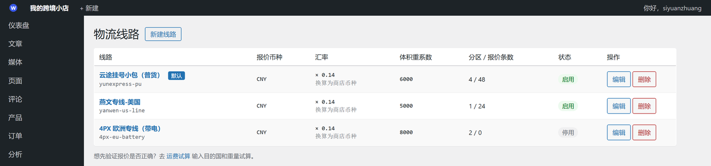
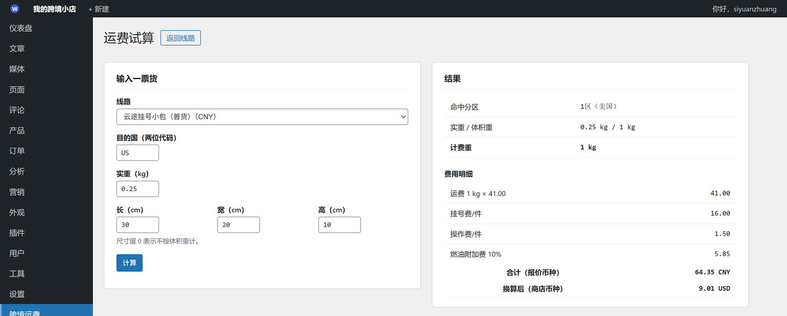
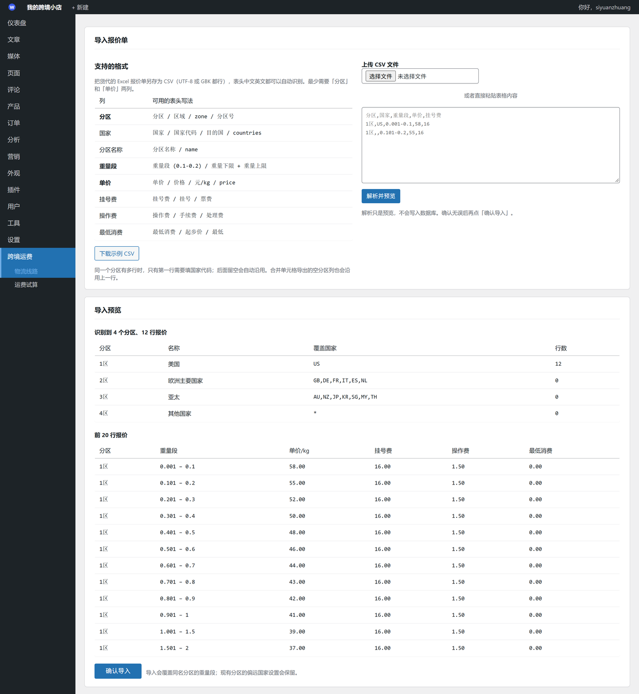
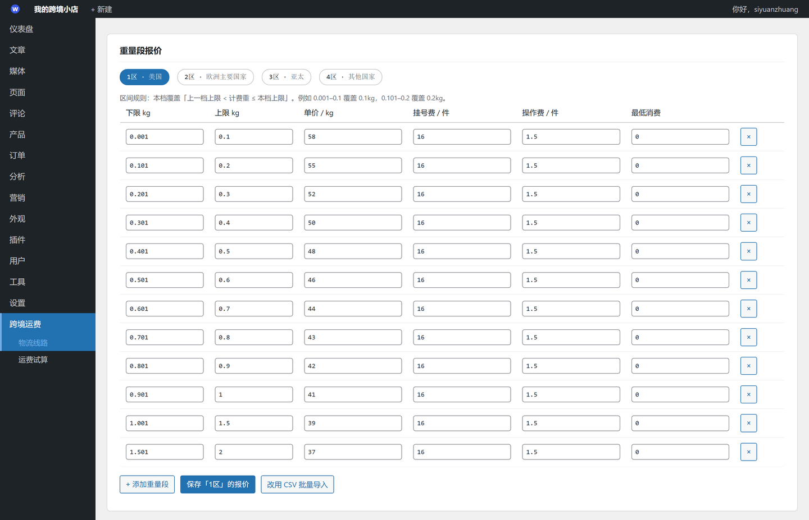

# 跨境物流运费 for WooCommerce

> 把国内货代/跨境专线给的**报价单（CSV）**直接导入 WooCommerce，按目的国分区、重量段、体积重和附加费自动计算跨境运费。

[](LICENSE)
[](https://www.php.net/)
[](https://wordpress.org/)
[](https://woocommerce.com/)
[](https://github.com/siyuanzhuang/crossborder-shipping-rates/actions/workflows/ci.yml)

**English** · [中文](#中文)

A WooCommerce shipping method that turns your **forwarder's rate sheet** (an Excel/CSV with zones, weight tiers, base fee and per-kg price) into working shipping rules — no more typing hundreds of numbers into a table-rate plugin.

Most Chinese cross-border sellers ship through a forwarder who hands them a spreadsheet: *zone 1 = US, 0.001–0.1 kg = ¥58/kg + ¥16 registration fee*, and so on. Existing table-rate plugins make you re-enter every cell by hand, and every rate change means doing it again. This plugin parses the sheet instead.

---

## 中文

### 为什么做这个

用 WooCommerce 做跨境独立站，运费算不准是常态：

- 货代给的是 Excel 报价单：按国家分区（1区/2区/A区），按重量分档（0.001–0.1kg、0.101–0.2kg…），每档有单价、挂号费、操作费、最低消费
- 报价单一个月变一次（燃油、旺季附加费），变一次就要重填一遍
- 通用「费率表」插件只认「条件 → 价格」，你得把 200 个格子一个个搬进去
- 物流商 API 插件绑死一家、要正式账号和授权，走货代的小卖家根本拿不到

市面调研见 [docs/01-市场调研与产品定位.md](docs/01-市场调研与产品定位.md)：**有零件，没有整机**。

这个插件只做一件事：**CSV 进，运费规则出。**

### 功能

| 能力 | 说明 |
| --- | --- |
| 📥 **报价单导入** | 中英文表头自动识别（`单价` / `单价(元/kg)` / `price`），UTF-8 / GBK 自动转码，逗号/制表符/分号分隔 |
| 🗺 **分区映射** | 报价单的「1区/2区」对应到国家代码，`*` 作兜底分区；合并单元格导出的空分区列自动沿用 |
| ⚖️ **两种计价模型** | 重量段查表（小包常见）/ 首重 + 续重（快递专线常见） |
| 📦 **体积重** | 长×宽×高÷系数（6000/5000/8000 可配），取实重与体积重较大值 |
| 🔢 **重量进位** | 0.001 / 0.01 / 0.1 / 0.5 / 1 kg，进位 / 四舍五入 / 精确；带浮点误差保护 |
| 💸 **附加费** | 燃油百分比、偏远地区、每票固定处理费、最低消费 |
| 💱 **汇率换算** | 报价 CNY、商店收 USD，一处配置全局生效 |
| 🧮 **后台试算器** | 输入目的国/重量/尺寸，看到计费重与逐项费用，用于对账 |
| 🚚 **配送方式** | 可放进任意配送区域，支持满额免运费、结算页展示费用明细 |
| 🔌 **不联网** | 不调任何第三方 API，报价数据只在你自己的数据库里 |

### 截图

<table>
<tr>
<td width="50%"></td>
<td width="50%"></td>
</tr>
<tr>
<td align="center"><sub>线路列表：一条线路 = 一个物流产品</sub></td>
<td align="center"><sub>运费试算：与结算页同一套算法</sub></td>
</tr>
</table>



<sub>导入报价单：先解析预览，确认分区、重量段、费用无误后再写入。</sub>



<sub>重量段报价：可以直接在表格里改，也可以整张表重新导入。</sub>

### 安装

**方式 A：后台上传**

后台 →「插件」→「安装插件」→「上传插件」→ 选择 `crossborder-shipping-rates-x.y.z.zip` → 安装 → 启用。

**方式 B：WP-CLI**

```bash
wp plugin install https://github.com/siyuanzhuang/crossborder-shipping-rates/releases/latest/download/crossborder-shipping-rates.zip --activate
```

**方式 C：源码**

```bash
cd wp-content/plugins
git clone https://github.com/siyuanzhuang/crossborder-shipping-rates.git
wp plugin activate crossborder-shipping-rates
```

前置条件：WordPress ≥ 5.9、PHP ≥ 7.4、WooCommerce ≥ 7.0（未启用 WooCommerce 时插件不会加载）。

### 三步用起来

**1. 建线路** ——「跨境运费 → 物流线路 → 新建线路」

一条线路 = 一个物流产品。填报价币种、汇率、体积重系数、重量进位、附加费。

**2. 导入报价单** —— 上传 CSV，先预览，确认后写入

```csv
分区,分区名称,国家,重量段,单价,挂号费,操作费,最低消费
1区,美国,US,0.001-0.1,58,16,1.5,0
1区,,,0.101-0.2,55,16,1.5,0
2区,欧洲,"GB,DE,FR",0.001-0.1,62,16,1.5,0
4区,其他,*,0.001-0.1,75,16,1.5,0
```

省事的约定：国家代码只需每个分区第一行填；分区列留空自动沿用上一行；表头带单位也认。

**3. 挂到配送区域** ——「WooCommerce → 设置 → 配送」→ 添加「跨境物流运费」→ 选线路

完整步骤：[docs/02-安装与使用.md](docs/02-安装与使用.md)

### 计价规则

```
计费重   = max(实重 + 包装重, 体积重) → 按进位规则取整
基础运费 = 该档单价 × 计费重 + 挂号费 + 操作费   (不足最低消费则补足)
最终价格 = (基础运费 + 燃油% + 偏远附加 + 固定处理费) × 汇率
```

**区间语义**与货代报价单一致：`0.001-0.1` 覆盖 **0.1kg**，`0.101-0.2` 覆盖 **0.2kg**。

```php
// 直接调用引擎（纯 PHP，不依赖 WordPress）
$quote = CBSR_Engine::quote(
    CBSR_DB::get_carrier( $carrier_id ),
    CBSR_DB::get_zones( $carrier_id ),
    CBSR_DB::get_rates( $carrier_id ),
    array( 'weight' => 0.5, 'country' => 'US' )
);
// $quote['ok'] / ['total'] / ['subtotal'] / ['billable_weight'] / ['zone_no'] / ['lines'] / ['errors']
```

可用过滤器：`cbsr_package_data`（接管整包数据，可接真实装箱算法）、`cbsr_package_dimensions`（只接管尺寸）。

### 开发

```bash
git clone https://github.com/siyuanzhuang/crossborder-shipping-rates.git
cd crossborder-shipping-rates

# 测试不依赖 WordPress，直接跑
php tests/test-engine.php   # 34 项：体积重、进位、分区匹配、重量段边界、整票报价、附加费、汇率
php tests/test-import.php   # 25 项：表头识别、重量段解析、GBK/BOM、分隔符、容错
php tests/test-views.php    # 36 项：后台模板渲染（最小 WP 桩函数）
```

代码结构：

```
crossborder-shipping-rates/
├── crossborder-shipping-rates.php     插件入口、常量、钩子
├── includes/
│   ├── class-cbsr-engine.php          计价引擎（纯 PHP，可单测）
│   ├── class-cbsr-db.php              线路/分区/重量段的读写
│   ├── class-cbsr-import.php          CSV 解析与编码处理
│   ├── class-cbsr-shipping-method.php WooCommerce 配送方式
│   └── class-cbsr-admin.php           后台页面与表单处理
├── admin/views/                       后台模板
├── assets/                            后台 CSS / JS
├── samples/example-rates.csv          示例报价单
├── tests/                             不依赖 WordPress 的测试
└── docs/                              调研与使用文档
```

### 路线图

- [ ] **v0.2 对账** —— 订单运费 vs 实际账单差额报表、报价单版本管理、国家从列表勾选
- [ ] **v0.3 更贴近真实报价单** —— xlsx 直接导入、多级表头、普货/带电/敏感货分表、超重自动分箱
- [ ] **v0.4 接通路** —— 云途/燕文/4PX/顺丰小包 API 适配层（作为报价来源之一，与 CSV 并列）
- [ ] **v0.5 运营** —— 批量改价、多站点/多仓库、权限分离

### 贡献

欢迎 Issue 和 PR，尤其是**报价单格式适配**——如果你手上的货代报价单长得不一样（多级表头、多工作表、特殊附加费），贴个脱敏样例过来，这比什么都值钱。

见 [CONTRIBUTING.md](CONTRIBUTING.md)。

### 许可证

[GPL-2.0-or-later](LICENSE)。WordPress 生态的惯例，也是为了确保衍生作品同样开源。

---

## 免责声明

运费计算结果仅供参考，实际费用以货代账单为准。上线前请务必先用试算器核对，并在结算页实测。
