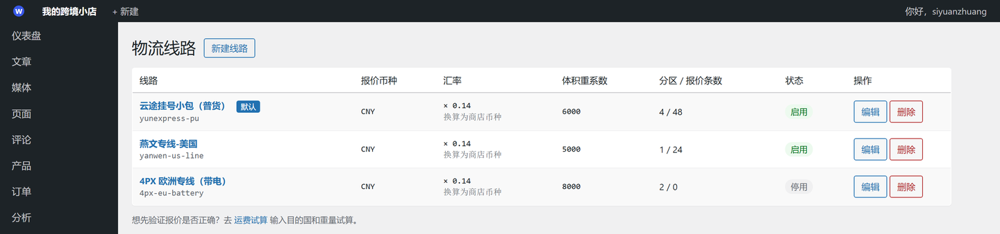
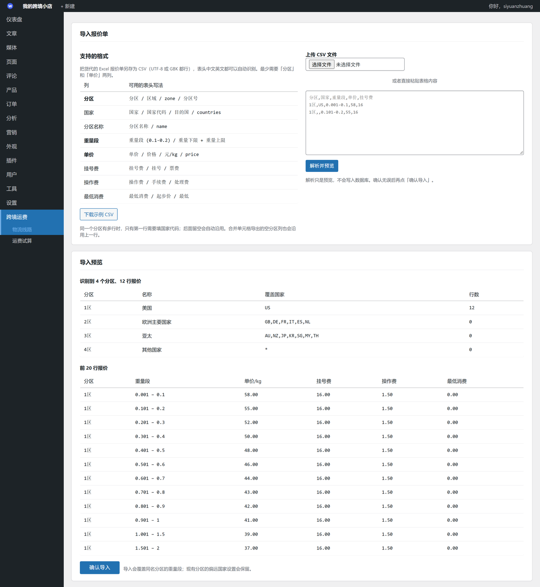
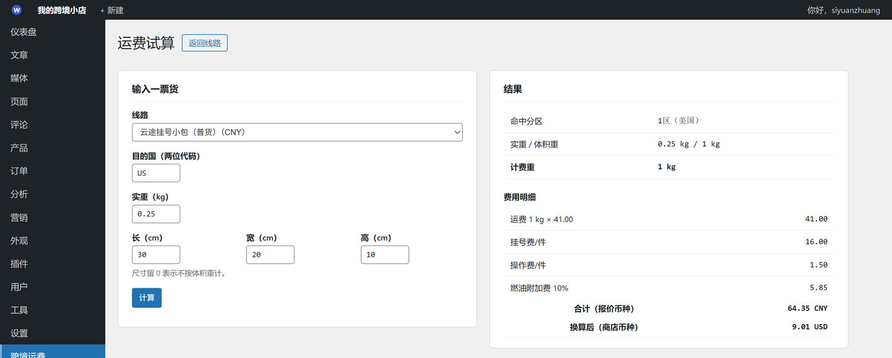
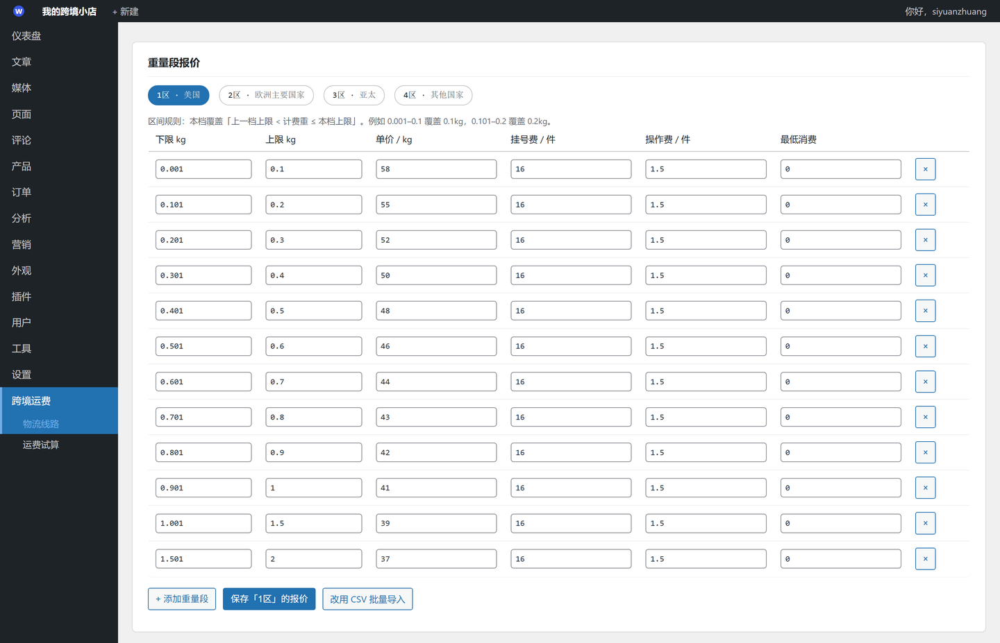

# 安装与使用

## 1. 安装

**方式 A：上传文件夹**

把 `crossborder-shipping-rates/` 整个目录复制到 `wp-content/plugins/`，后台「插件」里启用。

**方式 B：上传 zip**

把 `crossborder-shipping-rates/` 压成 zip，后台「插件 → 安装插件 → 上传插件」。

前置条件：WordPress ≥ 5.9、PHP ≥ 7.4、WooCommerce ≥ 7.0 已启用。

启用后左侧菜单出现 **跨境运费**，包含「物流线路」和「运费试算」两项。

---

## 2. 三步配好一条线路



### 第一步：建线路

「跨境运费 → 物流线路 → 新建线路」，填：

| 字段 | 说明 | 例子 |
| --- | --- | --- |
| 线路名称 | 一个物流产品一条 | 云途挂号小包（普货） |
| 报价币种 | 报价单的币种 | CNY |
| 汇率 | 1 报价币 = ? 商店币 | 美元店填 `0.14`；不换算填 `1` |
| 体积重系数 | 长×宽×高÷系数 | 6000（专线常用）；0 表示不算体积重 |
| 重量进位 | 按多少 kg 进位 | 0.01kg 进位 |
| 燃油附加费 | 按百分比加收 | 12.5 |
| 偏远附加费 | 每票固定额 | 35 |
| 包装附加费 | 每票固定额 | 2 |

保存后默认停在「基本设置」。

> **汇率要定期更新。** 插件不会自动抓汇率，这是刻意的——自动汇率会让对账变糊涂。

### 第二步：导入报价单



点「导入报价单」标签。

**先在 Excel 里整理表头**（中英文都认，顺序随意）：

```
分区,分区名称,国家,重量段,单价,挂号费,操作费,最低消费
1区,美国,US,0.001-0.1,58,16,1.5,0
1区,,,0.101-0.2,55,16,1.5,0
```

几个省事的约定：

- **国家代码**每个分区只写第一行，后面留空自动沿用。
- **分区号**留空也会沿用上一行（Excel 合并单元格导出的表就是这个样子）。
- **重量段**可以写 `0.001-0.1`，也支持 `0.1~0.2`、`≤0.1`、`0.1以上`。
- 拆成「重量下限」「重量上限」两列也行。
- 表头带单位无所谓：`单价(元/kg)`、`重量段（kg）` 都能识别。

然后「另存为 CSV」→ 页面上传（或直接把表格内容粘到文本框）→ **解析并预览**。

预览页会显示：识别到几个分区、每区多少行、前 20 行报价，以及：

- 🔴 **错误**：缺「分区」列 / 缺「单价」列 / 缺重量段 → 不会让你导入
- 🟡 **警告**：某行单价不是数字被跳过、区间重叠、分区没填国家代码

确认无误点「确认导入」。

> 导入是**按分区覆盖**：同名分区的重量段会被整体替换，其他分区不动。
> 分区的偏远国家设置会保留，不会被 CSV 覆盖。

### 第三步：挂到配送区域

「WooCommerce → 设置 → 配送 → 配送区域」：

1. 新建或选择一个区域（例如「美国」「欧洲」）。
2. 「添加配送方式」→ **跨境物流运费**。
3. 点开配置：
   - **报价线路**：选刚才那条线路（留空则用默认线路）
   - **包装重量**：每票额外加的包材重，例如 `0.03`
   - **体积重取数方式**：见下方说明
   - **固定箱规**：填 `30x20x10` 后忽略商品尺寸，统一按这个箱子算
   - **满额免运费**：订单小计达到该金额显示免运费
   - **展示费用明细**：结算页显示「计费重 / 分区 / 挂号费」等
   - **算不出价时**：隐藏（推荐）或显示「暂不支持该目的地」

**体积重取数方式**，WooCommerce 没有真实装箱算法，这里给三种近似：

| 方式 | 算法 | 适用 |
| --- | --- | --- |
| 按单件最大尺寸 | 各向取所有商品的最大值拼成一个虚拟箱 | 保守，体积重偏高，不容易亏 |
| 按各向尺寸相加 | 长宽高各自累加 | 粗略，多件时偏大 |
| 不计算体积重 | 只按实重 | 报价单本来就只按实重 |

要精确，用 `cbsr_package_dimensions` 过滤器接自己的装箱逻辑。

---

## 3. 验证：先试算，再看前台



「跨境运费 → 运费试算」：选线路、填目的国（两位码）、实重、尺寸 → 计算。

会输出：

```
命中分区      1（美国）
实重 / 体积重  0.2 kg / 1.0 kg
计费重         1.0 kg

运费 1 kg × 41.00        41.00
挂号费/件                16.00
操作费/件                 1.50
燃油附加费 10%            5.85
--------------------------------
合计（报价币种）          64.35 CNY
换算后（商店币种）         9.01 USD
```

对得上报价单，再去前台用一个真实地址走一遍结算，确认配送方式出现、价格一致。

---

## 4. 计价规则详解

### 4.1 计费重

```
实重 = 商品重量之和（换算成 kg）+ 包装重量
体积重 = 长 × 宽 × 高 ÷ 体积重系数       （三边都 > 0 才算）
计费重 = max(实重, 体积重) → 按进位规则处理
```

进位规则：

| 规则 | 0.101kg 的结果 |
| --- | --- |
| 0.01kg 进位 | 0.11 |
| 0.1kg 进位 | 0.2 |
| 0.5kg 进位 | 0.5 |
| 四舍五入 | 0.1 |
| 不进位 | 0.101 |

> 有浮点误差保护：0.1 + 0.2 会得到 0.3，不会被进位成 0.31。

### 4.2 分区匹配

1. 先找 `覆盖国家` 里精确包含目的国的分区；
2. 都没命中，就用 `覆盖国家 = *` 的兜底分区；
3. 还是没有 → 算不出价，按配送方式的「算不出价时」设置处理。

### 4.3 重量段查表（默认）



```
匹配规则：取第一条 weight_max ≥ 计费重 的记录，且计费重 ≥ 该记录 weight_min
```

所以报价单要这样写：

```
0.001-0.1     ← 覆盖 0.1kg
0.101-0.2     ← 覆盖 0.2kg
```

如果写成 `0-0.1` 和 `0.1-0.2`，0.1kg 会落进第一档（符合直觉），0.101kg 落进第二档。

金额：

```
基础运费 = 该档单价 × 计费重
         + 挂号费
         + 操作费
   若 < 最低消费 → 补足到最低消费
```

### 4.4 首重 + 续重

分区计价方式选「首重 + 续重」后，填：

- 首重 kg / 首重价
- 续重步进 kg / 续重价

```
基础运费 = 首重价 + ceil(max(0, 计费重 - 首重kg) / 续重步进) × 续重价 + 操作费
```

例：首重 0.5kg / 65，续重每 0.5kg / 22，计费重 1.2kg
→ `65 + ceil(0.7/0.5) × 22 = 65 + 2×22 = 109`

### 4.5 附加费顺序

```
基础运费
  + 燃油附加费（基础运费 × 百分比）
  + 偏远地区附加费（目的国在该分区的偏远列表里）
  + 包装/操作附加费（固定额）
  = 报价币种总价
  × 汇率 = 商店币种总价
```

燃油是**按基础运费**算的（含挂号费、操作费、最低消费补足），不是按商品金额。

---

## 5. 常见问题

**Q：前台看不到这个配送方式？**

依次排查：线路是否启用 → 分区是否填了目的国 → 该重量是否有档位 →
配送区域是否覆盖该国家 → 配送方式的「算不出价时」是否设成了隐藏。

**Q：报「超出该线路的最大重量」？**

报价表最大档的 `weight_max` 太小。补一档，或把最后一档的上限调大（如 `999999`）。

**Q：我想一个配送方式区分「普货 / 带电」？**

建两条线路，各自的报价表不同；挂成两个配送方式，名称写清楚（「专线-普货」「专线-带电」）。
按商品自动切换需要 v0.3 的商品维度规则。

**Q：改了汇率，已下单的订单会变吗？**

不会。订单里的运费是下单时算出来并存进订单的，改配置只影响之后的订单。

**Q：插件会往外发数据吗？**

不会。不联网、不埋点、不调第三方 API。报价数据只在你的数据库里。

**Q：卸载会删数据吗？**

会。`uninstall.php` 会删除三张表和插件选项。想留底就先备份。

---

## 6. 开发者接口

```php
// 接管整个包裹数据（重量、尺寸、目的地）
add_filter( 'cbsr_package_data', function ( $data, $package ) {
    $data['dimensions'] = my_packer( $package['contents'] );
    return $data;
}, 10, 2 );

// 只接管尺寸
add_filter( 'cbsr_package_dimensions', function ( $dims, $package ) {
    return $dims;
}, 10, 2 );
```

```php
// 直接调用计价引擎
$quote = CBSR_Engine::quote(
    CBSR_DB::get_carrier( $carrier_id ),
    CBSR_DB::get_zones( $carrier_id ),
    CBSR_DB::get_rates( $carrier_id ),
    array(
        'weight'     => 0.5,
        'country'    => 'US',
        'dimensions' => array( 'length' => 30, 'width' => 20, 'height' => 10 ),
    )
);

// $quote['ok'] / ['total'] / ['subtotal'] / ['billable_weight'] / ['zone_no'] / ['lines'] / ['errors']
```

引擎是纯 PHP，不依赖 WordPress，可以脱离 WP 跑测试：

```bash
php tests/test-engine.php   # 34 个用例：体积重、进位、分区、重量段、整票报价、附加费、汇率
php tests/test-import.php   # 25 个用例：表头识别、重量段解析、GBK/BOM、分隔符、容错
php tests/test-views.php    # 36 个用例：后台模板渲染（用最小 WP 桩函数）
```
